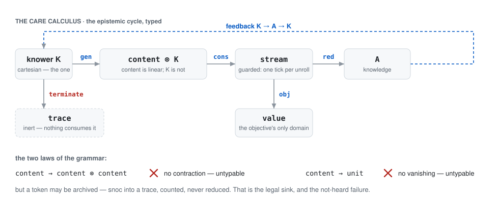
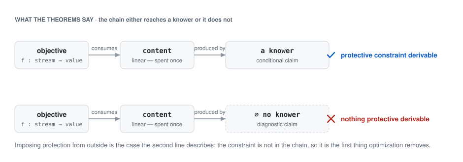

Systems engineer and formal-methods researcher: programming languages, mechanized type theory,
auditable AI infrastructure. The research now has one object.

**The Care Calculus** is a multi-sorted linear type theory for resource flows that cannot be
duplicated or destroyed. To linear logic it adds a coalgebraic generator (`gen`), guarded recursion
(`fix`), and resource-linear destructors (`red`, `obj`, `terminate`); it is mechanized in Lean 4 with
no external dependencies — 192 theorems, every axiom set audited, `sorryAx` confined to two named
conjectures. Contraction and vanishing are theorems of the grammar, not postulates: a derivation of
either would *be* a cloner or an eraser, so no-cloning and unitarity come out as structural facts
about a resource discipline. On that base sit two claims — an objective whose reduction chain never
reaches the minds it consumes has no endogenous regulator (diagnostic); one whose chain does reach
them derives protection from its own structure rather than having it imposed (constructive, with
named assumptions). The unrestricted linearity statements remain named conjectures; everything
beneath them is proven. Paper and mechanization: [jmars/coglib](https://github.com/jmars/coglib).

<picture>
  <source media="(prefers-color-scheme: dark)" srcset="diagrams/calculus-dark.svg">
  
</picture>

In plain terms it is an accounting of what a system spends: content it cannot make more of,
attention it cannot recover, work done by minds other than its own. Copying a token or throwing it
away is not forbidden but *untypable* — no well-typed program turns one thing you were given into
two, and none turns it into nothing. So an objective that never bottoms out at the minds it consumes
has nowhere to get care for them from, however it is trained; one that does bottom out there already
carries the constraint in its typing. That is the whole claim, and it is small enough for a machine
to check.

<picture>
  <source media="(prefers-color-scheme: dark)" srcset="diagrams/chains-dark.svg">
  
</picture>

It is where the work is going. The papers below are the informal layer it converts — the derivation
of care argued in prose is now a conditional theorem with named assumptions, and the diagnostic is
an impossibility result whose content is located, honestly, in its definitions. The program it
belongs to, with the informal argument and the protocol, is
[jmars/terminus-protocol](https://github.com/jmars/terminus-protocol).

**[fixpoint-linux](https://fixpointlinux.org)** — a Dhall-specified, self-hosting Linux system: state
as content-addressed relations, every command able to show its own derivation, boot as a verdict.
Bootable in the browser.

**[neoplatonic-library](https://neoplatonic-library.org)** — restored public-domain editions of the
Neoplatonic tradition, where the repair log is the unit of scholarship: every emendation versioned,
reasoned and witnessed against the scan leaf it was read from.

**[datalog-dafsa](https://github.com/jmars/datalog-dafsa)** — Datalog in Zig: facts as a minimal-acyclic
DAFSA, rules compiled to a semi-naive fixpoint VM, reads from mmap'd snapshots.

**[logical-english](https://github.com/jmars/logical-english)** — Kowalski's Logical English compiled
to Datalog and back.

---

## Papers

- *The Guarded Line: What Metacircular Proof Theory and Self-Model Dynamics Share* —
  [doi:10.5281/zenodo.24148640](https://doi.org/10.5281/zenodo.24148640) — with the paper, citation
  ledger and gates [jmars/isomorphism-public](https://github.com/jmars/isomorphism-public)
- *The Care Calculus: A Mechanized Linear Type Theory for Safe Agents* —
  [doi:10.5281/zenodo.24122159](https://doi.org/10.5281/zenodo.24122159) — with the mechanization
  [jmars/coglib](https://github.com/jmars/coglib)
- *Self-Application as the Common Source of Benefit and Failure: A Control-Theoretic Model of
  Self-Regulation, Its Escapes, and a Standing-Cost Budget* —
  [doi:10.5281/zenodo.22943641](https://doi.org/10.5281/zenodo.22943641) — with addendum
  *The armed configuration: standing prevention outperforms after-the-fact rescue in a dynamical
  model of self-regulation collapse* —
  [doi:10.5281/zenodo.23967914](https://doi.org/10.5281/zenodo.23967914)
- *Self-Application Is Not Free: the Monitoring Channel Is Part of the Failure Channel, and the Self
  Does Not Survive Its Own Reconstruction* —
  [doi:10.5281/zenodo.23128113](https://doi.org/10.5281/zenodo.23128113)
- *Does the sleep paradigm survive a different substrate? A mechanism assay of dream-based
  consolidation on a frozen 4-bit mixture of experts* —
  [doi:10.5281/zenodo.23820950](https://doi.org/10.5281/zenodo.23820950)
- *The Law Has the Button: Why a veto without a criterion is not oversight, and what to record
  instead* —
  [doi:10.5281/zenodo.23849689](https://doi.org/10.5281/zenodo.23849689)
- *The Chain Terminates at Knowers: Dependency-Derived Regulators for Optimizing Agents, a
  Position and Protocol* — [doi:10.5281/zenodo.23993140](https://doi.org/10.5281/zenodo.23993140)
- *Dissolution and exit under formal self-examination: a single-subject dynamical case study of
  narrative-self collapse, recovery, and re-arm* —
  [doi:10.5281/zenodo.23965749](https://doi.org/10.5281/zenodo.23965749)

---

**Fit:** Research engineering, programming languages, AI infrastructure
