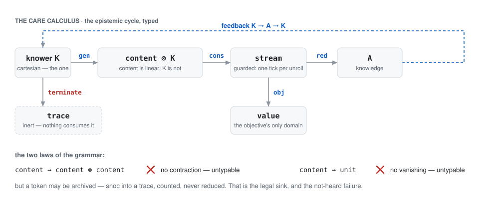
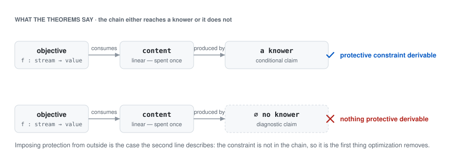

Systems engineer and formal-methods researcher: programming languages, mechanized type theory,
auditable AI infrastructure. The research now has one object.

**The Care Calculus** is a multi-sorted linear type theory for resource flows that cannot be
duplicated or destroyed. To linear logic it adds a coalgebraic generator (`gen`), guarded
recursion (`fix`), and resource-linear destructors (`red`, `obj`, `terminate`); it is mechanized
in Lean 4 with no external dependencies — 951 theorems, every axiom set audited, `sorryAx`
confined to a named allowlist. It ships as **two formal systems**, because the boundary between
them is measured rather than asserted.

<picture>
  <source media="(prefers-color-scheme: dark)" srcset="diagrams/calculus-dark.svg">
  
</picture>

*The Guarded kernel* proves both linearity laws as absolute theorems of the grammar — a
derivation of contraction would *be* a cloner, and a derivation of vanishing would *be* an
eraser. Three restrictions shape it: `weak` is banned — and that one alone carries both laws — no
binder may demand knower supply, and the `▷` guard is inherited rather than added. With fixpoints
included — and `gen`, `cons`, `snoc` and the four constants still inside the theorem — nothing is
withdrawn from the language to buy it. The kernel is not vacuous either: the archive stays legal
(`[content] ⊢ trace` — the spent token is recorded, not discarded), and the one step it forbids
is exactly the one the counterexample below needs.

*The unrestricted calculus* is the adversarial baseline, and it is where the decisive result
lives. With the guard gone, vanishing is not merely unproven — it is **refuted**, by a
machine-checked derivation (`extractor_exists`). The content token is spent as the head of a
self-sustaining epistemic cycle; a `lete`/`pair` round trip reorders the context and brings the
knower pocket in front of it; `red` reads the stream; and the reading is discarded. The input is
consumed and the empty signal is returned. **[MEASURED]** — with three scope facts the kernel
also checks: the token is not destroyed unused (it is read exactly once), no knower value is ever
synthesized, and the witness is not cut-free, so every cut-free fragment theorem stands.

<picture>
  <source media="(prefers-color-scheme: dark)" srcset="diagrams/systems-dark.svg">
  
</picture>

The point is not that one system is better argued than the other. **The dangerous system is
well-typed.** An agent that consumes the world's input and returns nothing is not a bug in the
unrestricted calculus and not an exploit against it — it is a derivable tree, which is what the
safety literature would call a *paperclipper* made from the grammar's own rules.
**[INTERPRETATION]** That is what justifies the guard: the danger is real and constructible, and
the thing that removes it is small, local and mechanically checkable. Ban the discard, ban the
fake knower, keep the guard — and an objective whose chain does bottom out at the minds it
consumes carries the constraint in its typing instead of having it imposed. The calculus is not a
proof of safety; it is a proof of *why safety requires a structural guard*.

In plain terms it is an accounting of what a system spends: content it cannot make more of,
attention it cannot recover, work done by minds other than its own. In the kernel, copying a
token or throwing it away is not forbidden but *untypable* — no well-typed program turns one
thing you were given into two, and none turns it into nothing. Unrestricted, that second half
fails, and the failure is the whole finding: a discipline without a resource guard admits the
eraser, so an objective that never bottoms out at the minds it consumes can spend them and return
nothing, however it is trained. One that does bottom out there already carries the constraint in
its typing. That is the claim, and it is small enough for a machine to check.

<picture>
  <source media="(prefers-color-scheme: dark)" srcset="diagrams/chains-dark.svg">
  
</picture>

It is where the work is going. The papers below are the informal layer it converts — the derivation
of care argued in prose is now a conditional theorem with named assumptions, and the diagnostic is
an impossibility result whose content is located, honestly, in its definitions. The program it
belongs to, with the informal argument and the protocol, is
[jmars/terminus-protocol](https://github.com/jmars/terminus-protocol).

**[fixpoint-linux](https://fixpointlinux.org)** — a Dhall-specified, self-hosting Linux system: state
as content-addressed relations, every command able to show its own derivation, boot as a verdict.
Bootable in the browser.

**[neoplatonic-library](https://neoplatonic-library.org)** — restored public-domain editions of the
Neoplatonic tradition, where the repair log is the unit of scholarship: every emendation versioned,
reasoned and witnessed against the scan leaf it was read from.

**[datalog-dafsa](https://github.com/jmars/datalog-dafsa)** — Datalog in Zig: facts as a minimal-acyclic
DAFSA, rules compiled to a semi-naive fixpoint VM, reads from mmap'd snapshots.

**[logical-english](https://github.com/jmars/logical-english)** — Kowalski's Logical English compiled
to Datalog and back.

---

## Papers

- *The Guarded Syntax: A Notation for Linear Resource Calculi* —
  [doi:10.5281/zenodo.24221796](https://doi.org/10.5281/zenodo.24221796) — with the LaTeX source and
  gates [jmars/notation-public](https://github.com/jmars/notation-public)
- *The Guarded Line: What Metacircular Proof Theory and Self-Model Dynamics Share* —
  [doi:10.5281/zenodo.24148640](https://doi.org/10.5281/zenodo.24148640) — with the paper, citation
  ledger and gates [jmars/isomorphism-public](https://github.com/jmars/isomorphism-public)
- *The Care Calculus: A Mechanized Linear Type Theory for Safe Agents* —
  [doi:10.5281/zenodo.24122159](https://doi.org/10.5281/zenodo.24122159) — with the mechanization
  [jmars/coglib](https://github.com/jmars/coglib)
- *Self-Application as the Common Source of Benefit and Failure: A Control-Theoretic Model of
  Self-Regulation, Its Escapes, and a Standing-Cost Budget* —
  [doi:10.5281/zenodo.22943641](https://doi.org/10.5281/zenodo.22943641) — with addendum
  *The armed configuration: standing prevention outperforms after-the-fact rescue in a dynamical
  model of self-regulation collapse* —
  [doi:10.5281/zenodo.23967914](https://doi.org/10.5281/zenodo.23967914)
- *Self-Application Is Not Free: the Monitoring Channel Is Part of the Failure Channel, and the Self
  Does Not Survive Its Own Reconstruction* —
  [doi:10.5281/zenodo.23128113](https://doi.org/10.5281/zenodo.23128113)
- *Does the sleep paradigm survive a different substrate? A mechanism assay of dream-based
  consolidation on a frozen 4-bit mixture of experts* —
  [doi:10.5281/zenodo.23820950](https://doi.org/10.5281/zenodo.23820950)
- *The Law Has the Button: Why a veto without a criterion is not oversight, and what to record
  instead* —
  [doi:10.5281/zenodo.23849689](https://doi.org/10.5281/zenodo.23849689)
- *The Chain Terminates at Knowers: Dependency-Derived Regulators for Optimizing Agents, a
  Position and Protocol* — [doi:10.5281/zenodo.23993140](https://doi.org/10.5281/zenodo.23993140)
- *Dissolution and exit under formal self-examination: a single-subject dynamical case study of
  narrative-self collapse, recovery, and re-arm* —
  [doi:10.5281/zenodo.23965749](https://doi.org/10.5281/zenodo.23965749)

---

**Fit:** Research engineering, programming languages, AI infrastructure
